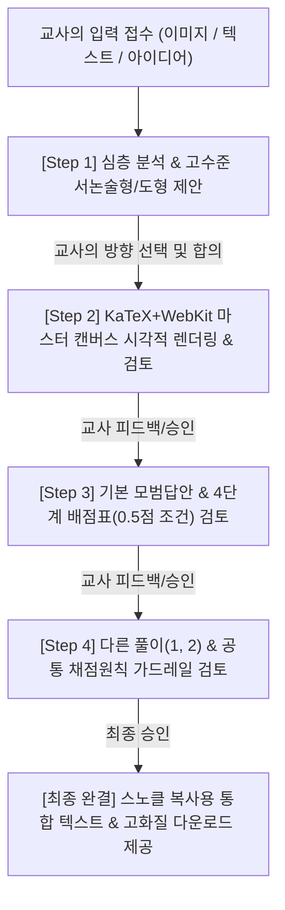

# Snorkl Rubric Architect 📐✨

> **Snorkl(스노클) 수학 서논술형 문항 캔버스 및 AI 4단계 정밀 루브릭 설계 시스템**  
> Claude Code, Google Antigravity / Gemini, OpenAI Codex, Aside 등 모든 주요 AI 에이전트에서 동작하는 통합 수학 문항 저작 스킬입니다.

[](https://github.com/getbetterwithu/snorkl-rubric-architect)
[](https://github.com/getbetterwithu/snorkl-rubric-architect)
[](LICENSE)

---

## 🚀 1초 원클릭 설치 (터미널)

터미널을 열고 아래 명령어를 붙여넣으면, Mac에 설치된 **Claude Code, Gemini/Antigravity, Codex, Aside**를 자동으로 감지하여 모든 도구에 스킬을 즉시 연동합니다:

```bash
curl -fsSL https://raw.githubusercontent.com/getbetterwithu/snorkl-rubric-architect/main/install.sh | bash
```

설치가 완료되면 터미널 어디서든 최신 버전으로 업데이트할 수 있는 `snorkl-update` 명령어가 등록됩니다:
```bash
snorkl-update
```

---

## 💡 주요 기능 및 핵심 가치

### 1. 양방향 서논술형 문항 승격 파이프라인
- **이미지만 제공 시**: 교과서/문제집 사진(단순 계산형 문제)을 분석하여, '수학적 정당화', '조건 변경', '증명 과정 단계화'를 유도하는 고수준 서논술형 문항으로 자동 제안 및 변형.
- **텍스트만 제공 시**: 지문 내용을 파악하여 학생들이 직관적으로 이해할 수 있는 최적의 기하 벡터 도형 작도를 선제 제안.

### 2. 한국 교과서 표준 기하 그래픽 엔진 (v12.0)
- **교과서 규격 순수 원호 치수선(Circular Arc)**: 선분의 두 꼭짓점을 현으로 삼아 $8\sim 16\text{px}$의 은은하고 일정한 활꼴 높이(Sagitta)를 유지하며, 왜곡 없는 진원호로 렌더링.
- **올록볼록 구름형 불투명 클라우드 마스크(Cloud-masked Label)**:
  - 글자 내부(숫자 사이, 띄어쓰기 공백, 내부 루프)는 $100\%$ 불투명 순백색으로 밀폐하여 뒤쪽 치수선 누출을 원천 차단.
  - 외부 윤곽은 글자 곡선을 따라 몽실몽실 올록볼록하게 이어지는 구름 형태로 자연스럽게 마스킹.
  - 소문자 윗줄($x, y, c, m$) $100\%$ 수평 일직선 정렬.
- **삼각함수 기반 내각 호(Angle Arc)**: 꼭짓점을 중심 원점으로 삼아 두 변에 $100\%$ 오차 없이 밀착하는 동심원호 작도 및 각의 이등분선 레이블 배치.
- **수학 타이포그래피**: 꼭짓점 영문 대문자 로만체 볼드(`Times New Roman Bold`), 변수 이탤릭($x, y$), 단위 직립 로만체($\text{cm}$), 선분 기호 밀착(`\overline{\mathrm{AB}}`).

### 3. Snorkl AI 채점 신빙성 보장 4단계 루브릭
- **4점 만점 체계**: 1단계(핵심 성질 발견) $\rightarrow$ 2단계(방정식/비례식 수립) $\rightarrow$ 3단계(계산 및 중간 결론) $\rightarrow$ 4단계(최종 결론 및 정당화) 각 1점 배분.
- **0.5점 정밀 부분점수 원칙**: 계산 실수나 근거 누락 시 0점 감점 대신 0.5점을 인정하는 명확한 기준 수립.
- **다중 풀이(Alternative Solutions) 완벽 대응**: 학생들이 시도할 수 있는 보조선, 닮음비 치환, 대수적 접근법을 최대 3개까지 병렬 루브릭으로 설계.
- **AI 억지감점 방지 10대 가드레일**: 교과서 특정 용어 누락에 의한 감점 방지, 시각적 추정에 대한 엄격한 0점 처리 등.

---

## 🏛️ 점진적 4단계 인터랙션 워크플로우

스킬이 실행되면 일방적으로 긴 텍스트를 쏟아내지 않고, 교사와 함께 문항과 평가 기준을 한 단계씩 완성해 나갑니다:



---

## 📂 파일 구조

```
snorkl-rubric-architect/
├── SKILL.md                          # 에이전트 공용 프롬프트 및 지침
├── install.sh                        # 원클릭 멀티 에이전트 설치 & 업데이트 스크립트
├── publish.sh                        # 듀얼 레포 동기화 배포 스크립트
├── README.md                         # 사용자 안내 문서
└── scripts/
    ├── template_card.html            # KaTeX 2000x1000 캔버스 마스터 HTML 템플릿
    ├── snorkl_geometry_engine.py     # 기하 벡터 그래픽 및 클라우드 마스크 엔진
    └── render_webkit.swift           # 무손실 WebKit 고화질 PNG 렌더러
```

---

## 🛠️ 지원 환경

- **OS**: macOS (WebKit 헤드리스 렌더링 및 Swift 컴파일러 내장 지원)
- **AI 에이전트**:
  - Google Antigravity / Gemini CLI (`~/.gemini/config/skills/`)
  - Anthropic Claude Code (`~/.claude/skills/`)
  - OpenAI Codex (`~/.codex/skills/`)
  - Aside 및 Universal Agent Skills 지원 플랫폼 (`~/.agents/skills/`)

---

## 📄 라이선스

MIT License © 2026 BetterwithU & getbetterwithu. All rights reserved.
