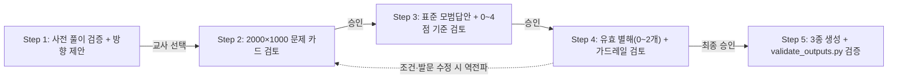

# Snorkl Rubric Architect 📐✨ (v15.0)

> **Snorkl(스노클) 중학교 수학 서논술형 문항 캔버스 · 정밀 채점 루브릭 · 교사용 A4 기준표 통합 저작 스킬**  
> Windows와 macOS를 모두 지원하며, Claude Code, Google Antigravity, OpenAI Codex, Aside 등 주요 AI 코딩 에이전트에서 동작합니다.

[](https://github.com/getbetterwithu/snorkl-rubric-architect)
[](https://github.com/getbetterwithu/snorkl-rubric-architect)
[](LICENSE)

---

## 🚀 설치 방법

> 💡 **보안 안내**: 원클릭 실행 전 스크립트 내용을 직접 검토하시려면 [install.ps1](https://github.com/getbetterwithu/snorkl-rubric-architect/blob/main/install.ps1) 또는 [install.sh](https://github.com/getbetterwithu/snorkl-rubric-architect/blob/main/install.sh)를 먼저 확인하시거나 아래 **수동 설치(`git clone`)** 방식을 사용하실 수 있습니다.

### 1) 원클릭 자동 설치
**🪟 Windows (PowerShell)**
```powershell
irm https://raw.githubusercontent.com/getbetterwithu/snorkl-rubric-architect/main/install.ps1 | iex
```

**🍎 macOS / Linux (Terminal)**
```bash
curl -fsSL https://raw.githubusercontent.com/getbetterwithu/snorkl-rubric-architect/main/install.sh | bash
```

### 2) 수동 검증 설치 (`git clone`)
```bash
git clone https://github.com/getbetterwithu/snorkl-rubric-architect.git ~/.snorkl-rubric-architect
# Windows PowerShell: powershell -ExecutionPolicy Bypass -File "$HOME\.snorkl-rubric-architect\install.ps1"
# macOS / Linux:      bash ~/.snorkl-rubric-architect/install.sh
```

설치 스크립트는 PC에 이미 설치된 에이전트 폴더(`~/.gemini`, `~/.claude`, `~/.codex`, `~/.agents`)만 감지하여 심볼릭 링크/Junction으로 안전하게 연결합니다.

---

## 💡 v15.0 핵심 특징

1. **단일 원본 파이썬 빌더(`snorkl_builder.py`) & 자동 검증기(`validate_outputs.py`)**
   - 하나의 확정 문항 객체(`ProblemSpec`)에서 **문제 카드 PNG(`2000×1000`) · 스노클 `정답/평가 기준` 텍스트(`.md`) · 교사용 기준표 PDF(A4)** 3종을 일관되게 생성합니다.
   - 인도 직전 `validate_outputs.py`가 PNG 해상도 헤더, `.md` 내 LaTeX 유출 여부, DOM 레이아웃 넘침, PDF 페이지 수, **카드-MD-PDF 간 수치·정답 교차 일치성**을 코드로 검증합니다.
2. **오프라인 100% 로컬 KaTeX 내장 (`scripts/vendor/katex/`)**
   - `katex@0.16.8` 스크립트·스타일시트 및 참조 수식 웹폰트(`.woff2` 20종 전수)를 로컬 번들링하여 사내망·학교 방화벽·오프라인 환경에서도 수식 깨짐 없이 렌더링됩니다.
3. **스노클 공식 이원 채점(`정오 판단 + 0~4점 정수 척도`) 및 음성(Voice) 통합**
   - 스노클 AI 실제 채점 사양에 맞춰 **최종 답 정오 판단(Correct/Incorrect)**과 **풀이 설명 점수(`0, 1, 2, 3, 4` 정수 척도)**를 분리 설계하며, 화이트보드 필기·도형 표시·음성 녹음(발화 중 자기 정정 포함)을 통합 인정합니다.
4. **2022 개정 중학교 수학과 교육과정 정밀 반영 (`references/korean_middle_math_standards.md`)**
   - **[공식 교육과정 범위] · [교과서 서술 관행] · [학생 답안 채점 정책]** 3층위를 분리하여, 교사용 모범답안에서의 고교 선행 침범은 차단하되 발문 제한이 없는 학생의 타당한 별해·선행 풀이는 억지 감점하지 않습니다.
5. **안전 기하 엔진 (`snorkl_geometry_engine.py`)**
   - 평행선 교점 오류 즉시 검출(`ValueError`), ㄱ자형 등 오목다각형 내부 안전 라벨점 자동 보정(`interior_label_point`), 원·호·점선·치수호·좌표평면 작도 헬퍼를 기본 제공합니다.
6. **매체별 수식 표기 3원화**
   - **대화창(Step 1~4)**: 읽기 편한 한국어 수학 기호(`사각형 ABCD`, `△ABE ∽ △CDF`, `∠A = 90°`)
   - **문제 카드 & 교사용 PDF**: 로컬 KaTeX 교과서급 수식 조판
   - **스노클 복사용 `.md`**: `$` 및 백슬래시 명령어가 0개인 순수 텍스트(Plain Text)

---

## 🏛️ 단계별 협업 파이프라인 (검토 4단계 + 최종 산출)



---

## 📂 저장소 구조 및 회귀 테스트

```text
snorkl-rubric-architect/
├── SKILL.md                             # 에이전트 실행 지침 (v15.0.0)
├── LICENSE                              # MIT License
├── README.md                            # 설치 및 사용 안내
├── install.ps1 / install.sh             # Windows / macOS·Linux 설치·업데이트 스크립트
├── publish.sh                           # 듀얼 레포 검증·배포 스크립트
├── references/
│   └── korean_middle_math_standards.md  # 2022 개정 중학 수학 3층위 표준 가이드
├── scripts/
│   ├── snorkl_builder.py                # 단일 원본(ProblemSpec) 3종 통합 빌더
│   ├── validate_outputs.py              # 규격·DOM 넘침·교차 일치성 자동 검증기
│   ├── snorkl_geometry_engine.py        # 안전 기하 벡터 & 내부 중심점 엔진
│   ├── render_card.py                   # 크로스 플랫폼 무결점 PNG/PDF 렌더러
│   ├── render_webkit.swift              # macOS WebKit 2x 네이티브 스냅샷 소스
│   ├── template_card.html               # 2000×1000 카드 마스터 템플릿
│   ├── template_teacher_sheet.html      # 교사용 A4 채점기준표 템플릿
│   └── vendor/katex/                    # 로컬 KaTeX 0.16.8 + woff2 수식 폰트 20종
├── examples/
│   ├── geometry_trapezoid_motion/       # 골든 예제 1: 기하·방정식 소문항 혼합형
│   └── algebra_linear_inequality/       # 골든 예제 2: 대수 화이트보드 여백형
└── tests/
    └── test_core.py                     # 기하·렌더러·검증기 자동 회귀 테스트
```

```bash
# 전체 단위·통합 회귀 테스트 실행
python -m unittest discover -s tests -v
```

---

## 📄 라이선스

[MIT License](LICENSE) © 2026 BetterwithU & getbetterwithu
